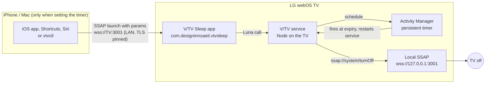

# V/TV Sleep

A sleep timer that lives on the TV. You send one short command from an iPhone (or a Mac), the TV stores the timer itself, and the TV switches itself off when it expires. No iPhone Wait action, no Mac, no server and no cloud is involved after the command is sent.

Verified on one TV: LG 43NU885BPLA, firmware 43.04.26, webOS SDK 11.0.1. Other models are untested.

## How it works



1. The phone launches the V/TV Sleep app on the TV over SSAP with `{mode, minutes}` as launch parameters.
2. The app calls its background service, which stores the deadline and registers a persistent Activity Manager job.
3. The phone is done. The service may exit; Activity Manager restarts it at expiry.
4. The service turns the TV off through the TV's own local SSAP endpoint. This is the only power-off route that worked (see `diagnostics/power-capabilities.json`): Luna `turnOff` does not exist and `machineOff` is denied.

## Why no iPhone Wait

A Shortcuts "Wait 30 minutes" needs the phone awake and connected for the whole time. Here the phone sends the command and can lock, leave the network or die. Timer survival across app close and service exit was observed on the TV (`diagnostics/test-results.md`, tests A, B, E, F, G, H1). Phone-off-Wi-Fi and phone-lock tests (C/D) need the iPhone app and are not complete.

## Why no Mac server

The Mac is used only for development and installation. The timer state and the power-off both run on the TV, so a sleeping or absent Mac changes nothing at runtime.

## Install

You need a Mac, the TV on the same network, and an LG developer account for the TV's Developer Mode app.

### 1. Mac setup

```
scripts/setup-webos.sh        # npm install, webOS CLI 3.2.6, service dependencies
scripts/check-environment.sh  # reports missing tools; Xcode absence is expected
```

### 2. Developer Mode on the TV

Install and open the **Developer Mode** app from the LG Content Store, sign in with your LG developer account, switch Developer Mode on, turn the Key Server on, and let the TV reboot. Note the IP address and the 6-character passphrase the app shows.

### 3. Connect

```
scripts/connect-tv.sh <TV_IP>
```

This registers the TV as the `tv` device and asks for the passphrase. If it fails, see `docs/troubleshooting.md`.

### 4. Install

```
scripts/build-tv.sh      # runs npm test, then builds build/*.ipk
scripts/install-tv.sh
```

### 5. Use on the TV

Press Home, open **V/TV Sleep**, pick 30, 45, 60, 90 or a custom number of minutes. The screen shows when the TV will switch off and lets you cancel. Launching directly from the TV does not interrupt whatever is playing.

Other helper scripts: `scripts/launch-tv.sh`, `scripts/test-tv.sh`, `scripts/logs-tv.sh`.

## Developer Mode

Developer-mode apps only stay while the TV's Developer Mode session has time left (about 1000 h after an extend). At 0 h the TV uninstalls them. Extend with the button in the TV's Developer Mode app; `ares-extend-dev` is not in CLI 3.2.6. Details and reinstall steps: `docs/dev-mode.md`, `scripts/extend-dev-mode.sh`.

## Pairing

The phone or Mac must be paired with the TV once over SSAP.

Mac:
```
scripts/vtvctl.sh pair --host <TV_IP>     # accept the prompt on the TV within 60 s
scripts/vtvctl.sh timer 30
scripts/vtvctl.sh cancel
scripts/vtvctl.sh off
```
The client key and the TV certificate pin are saved in `~/.config/vtv/tv.json` (mode 0600). `vtvctl pair --reset-pin` clears the pin if the TV's certificate legitimately changed.

iPhone: the planned iOS app pairs the same way as `vtvctl` (TV IP, then accept the prompt on the TV, and allow Local Network access when iOS asks). At the time of writing `ios/` contains only the shared `VTVCore` package that `vtvctl` uses; the iOS app itself is not in this repo yet and has never run on a device.

## iOS app and TestFlight

The iOS app is planned to be built by GitHub Actions and distributed through TestFlight; see `docs/ios-ci.md` for the setup. This needs an Apple Developer account and an App Store Connect API key.

## Shortcuts and Siri

Shortcuts, Home Screen, Control Center and Siri setup is described in `docs/shortcuts.md`; it depends on the iOS app.

## Troubleshooting

Short version; full list in `docs/troubleshooting.md`.

- `ares-novacom --getkey` fails: the TV's Key Server (port 9991) must be on; re-enable it and use the current passphrase.
- `luna-send-pub` needs `-i`, and the first call after the service idles can return empty; retry.
- `/tmp` is not writable on the TV; use `/media/developer/temp`.
- Timer not set from the phone: the client left before the app started (V/TV cold start is 3-4 s); the client waits 7 s.
- Apps vanished: Developer Mode expired; reinstall with `scripts/install-tv.sh`.

## Updating

```
git pull        # or copy the new release folder
scripts/build-tv.sh
scripts/install-tv.sh
```

## Uninstalling

```
scripts/uninstall-tv.sh                 # removes the app and service from the TV
rm -rf ~/.config/vtv                    # Mac credentials and pin
```
Delete the iOS app from the phone, if installed, to remove its stored credentials. Turn Developer Mode off in the TV's Developer Mode app if you no longer need it.

## Security

- LAN only. The phone talks to the TV over the local network; nothing goes to a cloud service. No telemetry.
- The TV's client key is stored in a 0600 file for `vtvctl` on the Mac. The iOS app is designed to keep it in the Keychain via the `CredentialStore` seam in `VTVCore`.
- Timer minutes are validated as whole numbers from 1 to 720 and rejected, not clamped.
- The SSAP registration manifest is unsigned, so the TV grants only the limited permission set it requests (`LAUNCH`, `CONTROL_POWER`, `READ_RUNNING_APPS`, `READ_APP_STATUS`, `READ_POWER_STATE`, `WRITE_NOTIFICATION_TOAST`).
- The TV's self-signed TLS certificate is pinned (SHA-256 of the leaf certificate, trust on first use). A changed certificate fails with a re-pair message.
- The developer SSH key (`~/.ssh/tv_webos`) stays on the Mac. It is not in the repo, the release folder or the iOS app.
- Anyone on your LAN who can pair with the TV can set a timer or turn it off, as with LG's own remote apps.

## Limitations

- Launching V/TV from the phone or Mac takes the TV foreground. With YouTube playing, YouTube is closed and reopens paused; relaunching it or calling `PalmSystem.deactivate()` from V/TV did not help. Netflix and HDMI inputs have not been tried. Setting the timer from the TV remote is unaffected.
- V/TV cold start takes 3-4 s, so the client waits 7 s after launching.
- Developer Mode expires (about 1000 h); apps are removed at 0 h and must be reinstalled. Only an LG Content Store app is permanent, and this is not one.
- TestFlight builds expire after 90 days and must be re-uploaded.
- Power-off relies on local SSAP from the TV service; a future firmware could block it.
- Tests not run on the TV: H2 (stale fire), H3 (standby mid-timer), H4 (unplug mid-timer), H5 (fresh pairing prompt). Test C/D with an iPhone are not complete. See `diagnostics/test-results.md`.
- Only one TV model and firmware has been tested.
- Building the iOS app needs CI (no Xcode on the development Mac); the iOS app has not been verified on a device here.
- `ares-extend-dev` is not available, so extending is manual.

## Repository layout

`tv-app/` TV UI, `tv-service/` timer service, `ios/VTVCore/` Swift package and `vtvctl`, `scripts/` tooling, `docs/` documentation (`PLAN.md` is the project log), `diagnostics/` on-TV evidence, `tests/` service unit tests (`npm test`), `release/` packaged release (`scripts/make-release.sh`).

## Returning to the calling app (0.1.1)

A launch with `{mode: "schedule", minutes}`, `{mode: "cancel"}` or `{mode: "status"}` may also carry `returnTo: '<app id>'`. After the service answers and the confirmation overlay has been on screen for about 1.4 s, V/TV Sleep reopens that app with `params: {timer: {op, minutes, shutdownAt, at}}` (`op` is `schedule`, `cancel`, `status` or `error`; `status` carries `scheduled` and, when true, `minutes` and `shutdownAt`). Only app ids in the fixed `RETURN_IDS` list in `tv-app/app.js` are honoured (currently `com.designinnsaeit.vhome`), because launch params can come from any paired LAN client. The app needs the `applications.operation` permission (added to `appinfo.json`). V/HOME uses this for its one-click timer.
